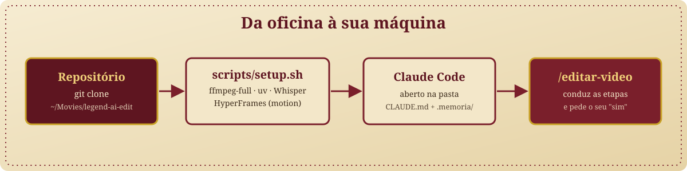
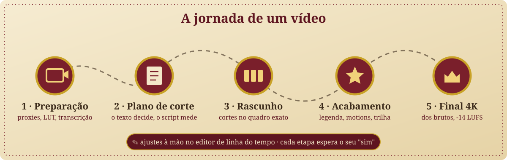
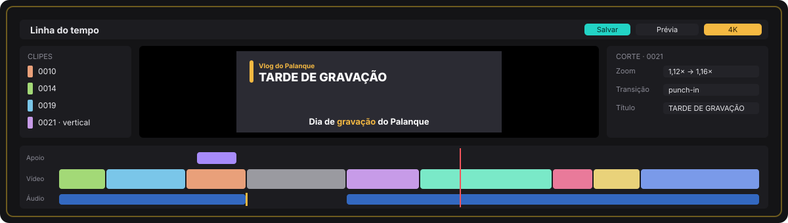

<a id="topo"></a>

<p align="center">
  
</p>

<p align="center">
  <strong>Oficina de Edição das Lendas da IA.</strong><br>
  Um toolkit para o Claude Code editar vídeo com você: do bruto da câmera ao 4K final, uma etapa aprovada por vez, com um editor de linha do tempo para os seus ajustes à mão.
</p>

<p align="center">
  <a href="#02--instale-a-oficina"><strong>INSTALAR →</strong></a>
  &nbsp;·&nbsp;
  <a href="#03--a-jornada-de-um-vídeo"><strong>EDITAR UM VÍDEO</strong></a>
  &nbsp;·&nbsp;
  <a href="#04--o-editor-de-linha-do-tempo"><strong>CONHECER O EDITOR</strong></a>
</p>

<p align="center">
  <a href="LICENSE"></a>
  
  
  
  
</p>

---

Toda lenda começa com um bruto de câmera. Este repositório é a oficina onde ele vira vídeo publicado.

Você abre o Claude Code nesta pasta, copia os arquivos do dia para `videos/<data>_<nome>/bruto/` e o Claude conduz a edição:
1. transcreve tudo localmente;
2. propõe os cortes em texto;
3. monta o rascunho;
4. faz o acabamento (legenda, zoom, motions, trilha, efeitos sonoros e loudness);
5. renderiza o 4K.

Cada etapa espera o seu "sim". Quando você quiser mexer sozinho, o editor de linha do tempo abre no navegador.

> **Para o Claude que está lendo isto:** o roteiro de instalação para você executar está em [`prompts/01-instalar.md`](prompts/01-instalar.md). Depois de instalado, as regras ficam no [`CLAUDE.md`](CLAUDE.md), e a skill [`/editar-video`](.claude/skills/editar-video/SKILL.md) conduz o trabalho.

## 00 / Escolha sua jornada

| Você quer... | Vá para |
| --- | --- |
| Instalar a oficina numa máquina nova | [02 / Instale a oficina](#02--instale-a-oficina) |
| Editar o primeiro vídeo | [03 / A jornada de um vídeo](#03--a-jornada-de-um-vídeo) |
| Ajustar cortes, zoom e títulos você mesmo | [04 / O editor de linha do tempo](#04--o-editor-de-linha-do-tempo) |
| Entender títulos animados, contador e nome na tela | [05 / Motions](#05--motions) |
| Saber o que é da oficina e o que é só seu | [06 / O que é da oficina e o que é seu](#06--o-que-é-da-oficina-e-o-que-é-seu) |
| Ensinar o seu estilo e a sua câmera | [07 / Faça a oficina ser sua](#07--faça-a-oficina-ser-sua) |
| Resolver um problema | [08 / Quando algo dá errado](#08--quando-algo-dá-errado) |

## 01 / Prepare a máquina

- **macOS com Apple Silicon** (M1 ou mais novo). A transcrição usa o MLX, e o encode usa o VideoToolbox.
- **[Homebrew](https://brew.sh)**, que instala o FFmpeg completo e o `uv`.
- **[Claude Code](https://claude.com/claude-code)**.
- **Node.js 22 ou mais novo**, via nvm, fnm, volta ou brew, para os motions do HyperFrames.
- **Espaço em disco:** uns 3 GB para as ferramentas e o modelo de transcrição, fora os seus vídeos. Bruto 4K ocupa bastante: 10 min dão uns 6 GB.
- **Opcional:** assinatura do **[Epidemic Sound](https://www.epidemicsound.com)**, para buscar e baixar música e efeitos sonoros direto pelo Claude.

## 02 / Instale a oficina

<p align="center">
  
</p>

**Pelo agente (recomendado).** Abra o Claude Code na pasta `~/Movies` e cole:

```text
Leia https://raw.githubusercontent.com/roberto-souza/legend-ai-edit/main/prompts/01-instalar.md e execute a seção "O que o agente faz".
```

O agente:
1. confere a máquina;
2. clona a oficina em `~/Movies/legend-ai-edit`;
3. mostra o que vai instalar e espera o seu "sim" a cada passo;
4. roda o setup e testa a transcrição com um áudio sintético;
5. pergunta pela sua câmera e pelo LUT;
6. cria a sua memória pessoal;
7. deixa a pasta do primeiro vídeo pronta.

**À mão.**

```bash
git clone https://github.com/roberto-souza/legend-ai-edit ~/Movies/legend-ai-edit
```

```bash
cd ~/Movies/legend-ai-edit && scripts/setup.sh
```

O `scripts/setup.sh` pode rodar de novo sem estragar nada. Ele instala:
- `ffmpeg-full` e `uv`, pelo [`Brewfile`](Brewfile);
- o ambiente Python (`.venv`), a partir do [`pyproject.toml`](pyproject.toml);
- o modelo `whisper-large-v3-turbo` em `.cache/` (uns 1,5 GB);
- o HyperFrames em `motion/`, com a versão fixa no `package.json`.

Depois, abra o Claude Code dentro de `~/Movies/legend-ai-edit`.

## 03 / A jornada de um vídeo

<p align="center">
  
</p>

Copie (não mova) os arquivos da câmera para `videos/AAAA-MM-DD_nome/bruto/` e chame `/editar-video` no Claude Code. Cada etapa tem o seu guia em [`docs/etapas/`](docs/etapas/).

| Etapa | O que acontece | Fica em |
| --- | --- | --- |
| 1 · Preparação | inventário, proxies 1080p com o LUT da câmera e transcrição local com tempo por palavra | `trabalho/inventario*.json`, `trabalho/proxies/`, `trabalho/transcricao/` |
| 2 · Plano de corte | o Claude escolhe os trechos **pelo texto**; um script acha cada frase na transcrição e calcula os quadros | `trabalho/plano_vNN.md` |
| 3 · Rascunho | corte no quadro exato, pausas tiradas pelo silêncio real do áudio, vertical sobre fundo desfocado, b-roll e imagem de apoio | `final/<vídeo>_rascunho_vNN.mp4` |
| 4 · Acabamento | legenda com a palavra falada em destaque, zoom, transições, títulos animados, contador na tela, trilha de fundo que abaixa sob a fala, efeitos sonoros e -14 LUFS | `final/<vídeo>_acabamento_vNN.mp4` |
| 5 · Final | o mesmo corte, renderizado em 4K a partir dos brutos | `final/<vídeo>_vNN.mp4` |

Regras que a oficina nunca quebra (estão em [`docs/regras.md`](docs/regras.md)):
- sua mídia nunca é movida, renomeada nem apagada;
- nenhum render é sobrescrito: cada versão ganha `_v01`, `_v02`…;
- uma etapa por vez, e cada uma parte da anterior aprovada;
- o Claude decide o texto, e os scripts calculam o tempo, com a taxa real de quadros (29,97 ≠ 30).

## 04 / O editor de linha do tempo

<p align="center">
  
</p>

Para ajustar sem pedir ao Claude a cada detalhe:

```bash
scripts/editor.sh
```

O editor abre em http://127.0.0.1:8765 com o vídeo mais recente. Ele só atende na sua máquina. Nele você:
- apara as bordas de cada corte e muda a ordem arrastando;
- divide com **S**, corta até o cursor com **Q**/**W** e apaga com **⌫**;
- escolhe o zoom de cada corte e o avanço suave, a transição (flash, punch-in, fade), o título, o nome na tela e o texto do contador;
- marca um corte como b-roll sem som, ou com glitch e preto e branco;
- insere qualquer clipe do dia pela biblioteca.

**Salvar** grava `trabalho/timeline_vNN.json`. **Renderizar prévia** e **Renderizar 4K** usam os mesmos scripts do Claude. Quando você voltar a pedir ajustes ao Claude, ele parte da sua linha do tempo mais recente.

## 05 / Motions

Os motions leves saem direto do FFmpeg:
- zoom suave nos cortes longos e zoom alternado nos cortes secos;
- transições de entrada;
- glitch com preto e branco para os imprevistos;
- legenda com a palavra falada em destaque.

Os motion graphics são feitos no **[HyperFrames](https://hyperframes.heygen.com)** (HTML, CSS e GSAP, licença Apache-2.0). Cada modelo fica em [`motion/`](motion/), e o texto entra por variável:

| Modelo | O que é |
| --- | --- |
| `motion/titulo` | título de bloco no alto, à esquerda, com selo e barra de destaque, entrando palavra por palavra |
| `motion/nome` | nome e função na parte de baixo, acima da legenda |

Os renders saem em ProRes 4444 com transparência e ficam em cache por texto. Veja [`docs/etapas/motion.md`](docs/etapas/motion.md) para criar modelos novos.

## 06 / O que é da oficina e o que é seu

| Camada | Onde vive | Vai para o git? |
| --- | --- | --- |
| Scripts, editor, modelos de motion | `scripts/`, `motion/` | sim |
| Regras e guias das etapas | `CLAUDE.md`, `docs/` | sim |
| Estilos e aprendizados | `estilos/`, `aprendizados.md` | sim, e cada canal tem o seu estilo |
| **Sua memória pessoal** (preferências, pessoas, jeito de falar) | `.memoria/`, `CLAUDE.local.md` | **não**: cada pessoa tem a sua |
| Seus vídeos, proxies, renders, músicas e efeitos sonoros baixados | `videos/`, `sfx/**/*.wav` | **não** |
| LUT da sua câmera | `luts/*.cube` | **não**: cada câmera tem o seu |
| Ferramentas e modelos | `.venv/`, `.cache/`, `motion/node_modules/` | **não**: o setup recria |

## 07 / Faça a oficina ser sua

- **Câmera:** coloque o LUT da sua câmera (o `.cube` de log para Rec.709) em `luts/`. Se você não grava em log, use `"lut": "nenhum"` na configuração de acabamento.
- **Estilo:** copie [`estilos/palanque.md`](estilos/palanque.md) para `estilos/<seu-canal>.md` e ajuste: tom, legenda, zoom, música, títulos. O Claude anota ali o que você aprovar.
- **Música e efeitos sonoros:** o [`.mcp.json`](.mcp.json) já traz o servidor do Epidemic Sound. Abra o Claude Code na pasta, aprove o servidor e entre com `/mcp`. Cada pessoa usa a própria assinatura, e a licença de uso no seu canal é sua.
- **Memória:** o Claude guarda em `.memoria/MEMORIA.md` o que aprende sobre você. Pode abrir e editar à vontade.

## 08 / Quando algo dá errado

| Sintoma | O que fazer |
| --- | --- |
| `subtitles` ou `lut3d` não existem no FFmpeg | rode `scripts/setup.sh`: a oficina usa o `ffmpeg-full` em `/opt/homebrew/opt/ffmpeg-full/bin`, não o `ffmpeg` do PATH |
| A transcrição baixa o modelo de novo | importe `lae` antes de `mlx_whisper`, porque é ele que aponta o `HF_HOME` para `.cache/` |
| O título animado não renderiza | o modelo carrega o GSAP pela internet (CDN); confira a conexão e rode `npx hyperframes check` dentro de `motion/titulo` |
| O editor não abre | `scripts/editor.sh` sobe o servidor na porta 8765; se ela estiver ocupada, use `PORT=8766 scripts/editor.sh` |
| A legenda erra uma palavra | peça ao Claude para anotar em `trabalho/correcoes_legenda.json`; a transcrição original não muda |

## Créditos

O fluxo de motion e várias armadilhas do HyperFrames vêm do [fluxo-de-edicao](https://github.com/LeiteZ/fluxo-de-edicao), de Lucas Leite. O formato deste README segue o do [legend-ai-toolkit](https://github.com/roberto-souza/legend-ai-toolkit).

Ferramentas usadas:
- [FFmpeg](https://ffmpeg.org);
- [mlx-whisper](https://github.com/ml-explore/mlx-examples) (MIT);
- [HyperFrames](https://github.com/heygen-com/hyperframes) (Apache-2.0);
- [GSAP](https://gsap.com);
- [Epidemic Sound](https://www.epidemicsound.com) (assinatura de cada pessoa).

## Licença

[MIT](LICENSE) © 2026 Roberto Pedroso de Souza.

<p align="right"><a href="#topo">Voltar ao topo ↑</a></p>
